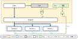
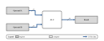
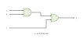
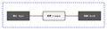

# Circuit Figure

A drawing Skill and small code library for circuit, datapath, block and system
architecture figures. Describe the design, fix its connections, and generate
HTML with inline vector SVG, a PNG preview and a JSON drawing record. An
optional Windows exporter recreates the drawing as editable Visio shapes.

## Example gallery

These previews are generated with the bundled library. Follow the source links
to reuse or adapt each drawing.

### Control block and parallel workers



A control region combines stored state and logic gates to dispatch work to
three workers. Separate bus and control tracks show the completion feedback.
[Drawing source](examples/example_pipeline.mjs).

### Register datapath



Two operand registers feed an ALU, which writes the result register. Thick
wires and width labels distinguish the 16-bit data buses.
[Drawing source](examples/example_datapath.mjs).

### Combinational logic



Standard AND and OR symbols implement `y = (a AND b) OR c`, with orthogonal
scalar signal wires attached to the gate boundaries.
[Drawing source](examples/example_logic.mjs).

Regenerate all committed SVG previews from the repository root:

```sh
node examples/build_gallery.mjs
```

The gallery builder rejects detected wire crossings and drawing warnings.
To export any example as HTML/JSON and, with Chrome or Edge, PNG, use
`lib/build.mjs` as shown below with the corresponding source path.

## Install the Skill

Clone into your agent's skills directory, for example:

```sh
git clone https://github.com/cgy0071/circuit-figure.git ~/.claude/skills/circuit-figure
```

Ask the agent to use `circuit-figure`, describe the figure and provide its
connections or design source. [SKILL.md](SKILL.md) contains the drawing workflow.
Other agents can load that file through their own skill/context mechanism.
You can also use the library directly without an agent.

## Build the example

Use Node.js with ES module support; this release was checked with Node 24.13.1
on Windows. The JavaScript library uses Node built-ins and needs no npm install.
From the repository root:

```sh
node lib/build.mjs examples/example_pipeline.mjs --out examples/out --strict
```

The example draws a control block and three workers. Outputs are
`examples/out/example_pipeline.html`, `.json` and, when a supported browser is
available, `.png`. Open the HTML in a browser to inspect the vector drawing.
Generated outputs are ignored by Git.

PNG rendering needs Chrome or Edge. Pass `--chrome /path/to/browser` or set
`CHROME` if discovery fails. For HTML/JSON only:

```sh
node lib/build.mjs examples/example_pipeline.mjs --out examples/out --no-png --strict
```

`--strict` fails on detected wire crossings or drawing warnings. It does not
check circuit correctness, and a missing browser or failed screenshot can still
leave a successful exit status: check that the PNG exists. The CLI writes inline
SVG inside HTML; call `Fig.svg()` to obtain standalone SVG text.

## Draw your own figure

Copy `examples/example_pipeline.mjs`, preserving its library import path, then
change the fixed netlist, placement and wire tracks. Work in millimetres. Keep
connections fixed while adjusting layout, and inspect each rendered result.

[reference/api.md](reference/api.md) lists shapes, gates, wires, text, styles
and diagnostic helpers. `lib/build.mjs` documents its CLI flags. A module may
export `parts` to generate separate panels from the same drawing functions.

## Optional Visio export

Requires Windows, Microsoft Visio 2013 or newer, Python and `pywin32` in that
Python environment. These dependencies are separate from the HTML/PNG route.

```sh
python lib/to_visio.py examples/out/example_pipeline.json --out examples/out
```

This writes `.vsdx` and a Visio-rendered `_visio.png` in a dedicated invisible
Visio session, which is closed after export or failure. Use `--no-png` for only
Visio, `--require-version 16` to check the registered application, and
`--font-asian SimSun` to override the Chinese/East Asian font.

The entire output batch is checked before starting Visio. Existing requested
outputs are rejected unless `--overwrite` is passed. With `--no-png`, existing
PNG previews are left alone. Duplicate output paths within a batch are rejected.

`--attach` explicitly enables the previous shared-session route. It restores
the alert setting, retains the session's raster resolution, and never quits the
shared application. `--dpi` applies to private sessions only. Selecting an
executable with `--visio PATH` requires `--attach`; private sessions use the
registered COM server. With multiple Office versions, the registered server
may differ from the latest installed executable; version errors report it.

## Optional personal style

`paper-bold` offers grey modules, dark memory blocks with white labels, bold
text, blue region outlines and separate Times New Roman / SimSun fonts:



```js
import { Fig, stylePreset } from './lib/figlib.mjs';
stylePreset('paper-bold');
const f = new Fig(120, 35, 'My figure');
f.mem(8, 13, 25, 10, 'Input');
```

See [the bilingual example](examples/example_paper_style.mjs). Build it with
`node lib/build.mjs examples/example_paper_style.mjs --out out/paper --strict`.
Sizes are specified at the final figure scale; this is an adapted preset,
not an exact reproduction of another author's large-canvas layout. Use
`stylePreset('default')` before drawing the next figure to restore the base
style. Presets and `setStyle()` are process-wide: render/export a figure before
switching them. `theme('paper-bold')` changes colours only; for independent
font control use `setStyle({ fontAsian: 'SimSun' })`.

The optional style and export improvements were informed by
[visio-sci-figure](https://github.com/1183029827/visio-sci-figure).

## Validation and limits

GitHub Actions runs the portable smoke tests, JavaScript and Python syntax
checks, and a strict HTML/JSON example build on Windows and Linux with Node.js
22 and 24. Checks run for pull requests and pushes to `main`, and can also be
started manually from the Actions tab. PNG rendering and Visio COM export
require separate validation in an environment with those applications installed.
Dependabot checks the pinned GitHub Actions dependencies weekly and opens
update pull requests.

For this publication, the bundled example built with zero detected crossings
and no drawing warnings; its HTML/JSON and an Edge-rendered PNG were checked,
and the PNG was visually inspected. Run the portable smoke checks with:

```sh
node tests/smoke.mjs
node tests/style.mjs
python -B -m unittest discover -s tests -p "test_*.py" -v
```

The smoke checks cover the example, split-panel output, named exports, custom
output names, HTML/JSON-only mode and strict rejection of crossing wires. They
do not cover every library function, option combination, font or operating
system. Crossing checks concern recorded wires, not electrical validity or all
visual overlaps. Offline Visio tests cover overwrite protection, output-path
collisions, bilingual font mapping, failure cleanup and session ownership.
They use fake COM objects and do not establish rendering fidelity. The optional
style was browser-rendered and visually inspected; a live Visio check detected
a registered Visio 12.0 COM server, so a successful VSDX export with the updated
exporter has not yet been verified on Visio 2013 or newer.

## Repository contents

- `SKILL.md`: instructions for the drawing agent.
- `lib/`: drawing library, builder and optional Visio exporter.
- `examples/`: editable example source.
- `docs/images/`: generated SVG previews displayed in this README.
- `reference/api.md`: library reference.
- `tests/smoke.mjs`: dependency-free smoke checks.

## License

No license is included in this publication.
